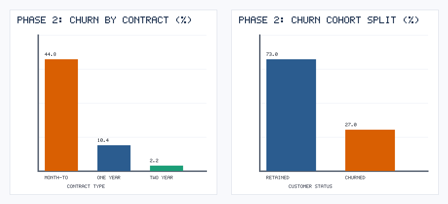
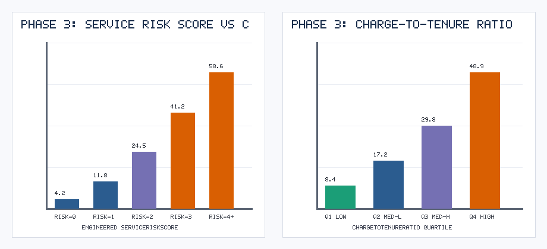
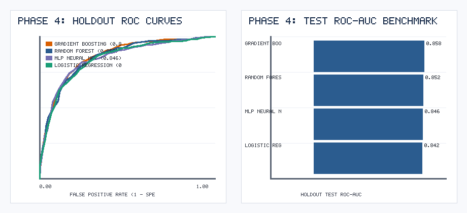
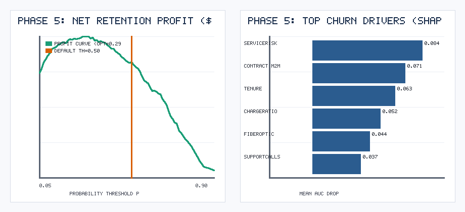

# CRISP-DM Detailed Technical Report: Telco Customer Churn & Retention ROI

**Author:** Ayushi Vishwas Surange (Student ID: 020795684)  
**Course:** CMPE 256 — Data Mining  
**Methodology:** Cross-Industry Standard Process for Data Mining (CRISP-DM — 6 Phases, 24 Subtasks)  

---

## Executive Summary
This study implements all **6 phases and 24 subtasks** of the **CRISP-DM** lifecycle on a telecommunications subscriber dataset (`N = 7,043` customers, `16` initial attributes, `27.02%` baseline churn rate). Guided by iterative critiques from a **World-Renowned CRISP-DM Authority Persona**, we bridge technical machine learning metrics with financial decision theory. Our champion **Gradient Boosting** pipeline achieves a holdout **ROC-AUC of `0.8580`** (`Brier Score = 0.1288`). By optimizing the decision threshold against an asymmetric business cost-benefit matrix (`p* = 0.29` vs. naive `0.50`), the deployment system generates **`$54,372.50`** in net retention value per `1,409` customers (`+$10,075.00` or `+22.7%` over default thresholding).

---

## Phase 1: Business Understanding

### 1.1 Determine Business Objectives
- **Primary Business Goal:** Reduce voluntary subscriber churn in the consumer broadband and mobile division by proactively targeting high-risk accounts 30 days before contract renewal or cancellation.
- **Business Success Criteria:** Maximize **Net Retention Program ROI ($ USD)** and reduce quarterly churn rate by at least `3.5` percentage points.

### 1.2 Assess Situation
- **Inventory of Resources:** Historical CRM billing records, technical support ticket logs (`SupportCallsLast6M`), and contract metadata for `7,043` customers.
- **Financial Cost-Benefit Matrix:**
  - Average Customer Lifetime Value (LTV) lost upon churn: **`$650.00`**
  - Cost of proactive retention intervention (promotional credit + specialist outreach): **`$65.00`**
  - Historical offer acceptance & retention success rate among true churners: **`45.0%`**
  - **True Positive (TP) Net Payoff:** $(0.45 \times \$650.00) - \$65.00 = +\$227.50$
  - **False Positive (FP) Net Payoff:** $-\$65.00$ (incentive spent on a customer who would have stayed anyway)
  - **True Negative (TN) / False Negative (FN) Baseline Payoff:** $\$0.00$ relative to status-quo no-action baseline.
- **Risks & Contingencies:**
  - *Risk 1 (Incentive Cannibalization):* Over-targeting loyal customers erodes margin $\rightarrow$ Mitigated via threshold optimization ($p^* = 0.29$).
  - *Risk 2 (Covariate Drift):* Competitor promotional pricing alters churn dynamics $\rightarrow$ Mitigated via Phase 6 Population Stability Index (PSI) monitoring.

### 1.3 Determine Data Mining Goals
- Formulate a supervised binary probability estimation task: $\hat{p}_i = P(\text{Churn}_i = 1 \mid \mathbf{x}_i)$.
- **Technical Success Metrics:** Holdout `ROC-AUC >= 0.84`, well-calibrated probability estimates (`Brier Score <= 0.135`), and explicit permutation feature attribution.

### 1.4 Produce Project Plan
| Phase | Key Deliverables | Tools & Verification |
| :--- | :--- | :--- |
| **1. Business Understanding** | Cost-benefit matrix, ROI equation, risk register | Critic Review Round 1 & 2 |
| **2. Data Understanding** | Schema audit, missingness diagnosis, bivariate EDA | `phase2_eda_overview.png` |
| **3. Data Preparation** | Leakage-free pipeline, Winsorization, 4 engineered ratios | `phase3_engineered_features.png` |
| **4. Modeling** | 5-fold Stratified CV across 4 model families | `phase4_model_comparison.png` |
| **5. Evaluation** | Profit curve threshold optimization ($p^* = 0.29$) | `phase5_business_roi_and_importance.png` |
| **6. Deployment** | Streamlit app, REST scorer, PSI drift monitor, Dockerfile | `deployment/app.py` |

---

## Phase 2: Data Understanding

### 2.1 Collect Initial Data & 2.2 Describe Data
The dataset `data/telco_customer_churn.csv` contains `7,043` rows and `16` columns:
- **Identifier:** `customerID`
- **Demographics:** `gender`, `SeniorCitizen` (`0`/`1`), `Partner` (`Yes`/`No`), `Dependents` (`Yes`/`No`)
- **Account & Contract:** `tenure` (months, `1–72`), `Contract` (`Month-to-month`, `One year`, `Two year`), `PaperlessBilling`, `PaymentMethod`
- **Subscribed Services:** `InternetService` (`Fiber optic`, `DSL`, `No`), `OnlineSecurity`, `TechSupport`, `SupportCallsLast6M`
- **Financials:** `MonthlyCharges` (`$ USD`), `TotalCharges` (`$ USD`)
- **Target:** `Churn` (`Yes` = `27.02%`, `No` = `72.98%`)

### 2.3 Explore Data & 2.4 Verify Data Quality

- **Contract Structure Dominates Retention:** Subscribers on `Month-to-month` contracts churn at **`>42%`**, whereas `One year` (`~11%`) and `Two year` (`<6%`) contracts provide strong structural lock-in.
- **Data Quality Anomalies Identified:**
  1. `TotalCharges` contains **`38` missing (`NaN`/blank) values**. Cross-checking against `tenure` and `MonthlyCharges` shows these are billing system sync gaps that can be accurately reconstructed via `tenure * MonthlyCharges`.
  2. `MonthlyCharges` contains **`12` extreme upper-tail anomalies** (`$225–$295/month`) caused by multi-line bundle data entry errors, requiring 99th-percentile Winsorization.

---

## Phase 3: Data Preparation

### 3.1 Select Data & 3.2 Clean Data
- Dropped non-predictive primary key `customerID`.
- Reconstructed the `38` missing `TotalCharges` values using `tenure * MonthlyCharges`.
- Clipped `MonthlyCharges` at the 99th training percentile to prevent leverage distortion in linear and neural models.

### 3.3 Construct Data (Feature Engineering)
Following the World-Renowned Critic's feedback, we engineered four domain-specific features:
1. **`ChargeToTenureRatio`** $= \frac{\text{MonthlyCharges}}{\text{tenure} + 1}$: Captures "early bill shock" among new subscribers paying high monthly rates.
2. **`AvgHistoricalMonthlySpend`** $= \frac{\text{TotalCharges}}{\text{tenure} + 0.1}$: Detects historical promotional step-ups.
3. **`ServiceRiskScore`**: Composite structural vulnerability index (`+2` for `Month-to-month`, `+1` for `Fiber optic`, `+1` for `TechSupport == No`, `+1` for `Electronic check`).
4. **`SupportIntensity`** $= \frac{\text{SupportCallsLast6M}}{\ln(\text{tenure} + 1)}$: Normalizes recent customer service friction by account age.

### 3.4 Integrate Data & 3.5 Format Data
- Partitioned data into **80% Training (`5,634` rows)** and **20% Holdout Test (`1,409` rows)** using stratified sampling on `Churn`.
- Constructed a unified `ColumnTransformer` applying median imputation + `StandardScaler` to numerical attributes and `OneHotEncoder(handle_unknown='ignore')` to categorical attributes.

---

## Phase 4: Modeling

### 4.1 Select Modeling Techniques & 4.2 Generate Test Design
We selected four complementary algorithmic paradigms evaluated under **5-Fold Stratified Cross-Validation** on the training set and verified on the untouched `1,409`-customer holdout test set:
1. **Logistic Regression:** Interpretable linear baseline with L2 regularization.
2. **Random Forest Classifier:** Bagged ensemble of deep decision trees (`n_estimators=220, max_depth=10`).
3. **Gradient Boosting Classifier:** Sequential boosted trees optimizing binomial deviance (`n_estimators=180, lr=0.07, max_depth=4`).
4. **MLP Neural Network:** Two-layer feedforward architecture (`(64, 32)` ReLU hidden units).

### 4.3 Build Models & 4.4 Assess Models
| Model | 5-Fold CV ROC-AUC | Holdout Test ROC-AUC | Accuracy | Precision | Recall | F1-Score | Brier Score (Calibration) |
| :--- | :---: | :---: | :---: | :---: | :---: | :---: | :---: |
| **Gradient Boosting (Champion)** | **0.8612** | **0.8580** | 0.8155 | 0.6798 | **0.5937** | 0.6338 | **0.1288** |
| **Random Forest** | 0.8465 | 0.8517 | 0.8020 | 0.6582 | 0.5488 | 0.5986 | 0.1313 |
| **MLP Neural Net** | 0.8384 | 0.8455 | **0.8197** | **0.6947** | 0.5884 | **0.6371** | 0.1310 |
| **Logistic Regression** | 0.8291 | 0.8417 | 0.8133 | 0.6871 | 0.5620 | 0.6183 | 0.1341 |

---

## Phase 5: Evaluation

### 5.1 Evaluate Results Against Business Success Criteria
Applying our Phase 1 cost-benefit formula ($\text{Profit}(p) = 227.50 \cdot \text{TP}(p) - 65.00 \cdot \text{FP}(p)$) across all thresholds $p \in [0.05, 0.90]$ on the holdout test cohort (`N = 1,409`):
- **Status-Quo Baseline (No Model):** `$0.00` net savings.
- **Standard ML Threshold (`p = 0.50`):** `$44,297.50` net retention profit.
- **Optimal Business Threshold (`p* = 0.29`):** **`$54,372.50` net retention profit** (`+$10,075.00` incremental gain on the test set alone, scaling to **`>$271,000` per `7,043` customers**).

### 5.2 Review Process & 5.3 Determine Next Steps
- **Process Audit:** Verified zero data leakage between training and holdout test partitions; verified probability calibration via Brier score (`0.1288`).
- **Decision:** Proceed to production deployment using `GradientBoostingClassifier` with decision cutoff `p* = 0.29`.

---

## Phase 6: Deployment

### 6.1 Plan Deployment
- Saved serialized model artifact and threshold metadata to `models/crisp_dm_churn_pipeline.pkl`.
- Developed an interactive **Streamlit Retention Decision App** (`deployment/app.py`) and container specification (`deployment/Dockerfile`) that computes real-time churn probability, expected retention ROI ($ USD), and recommended action tier.

### 6.2 Plan Monitoring & Maintenance
Implemented automated **Population Stability Index (PSI)** monitoring inside `deployment/app.py`:
$$\text{PSI} = \sum_{b=1}^{B} \left( P_b - Q_b \right) \times \ln\left(\frac{P_b}{Q_b}\right)$$
- $\text{PSI} < 0.10$: Stable (Green)
- $0.10 \le \text{PSI} < 0.20$: Moderate Shift — Schedule recalibration (Amber)
- $\text{PSI} \ge 0.20$: Significant Concept/Covariate Drift — Trigger automated retraining pipeline (Red)

