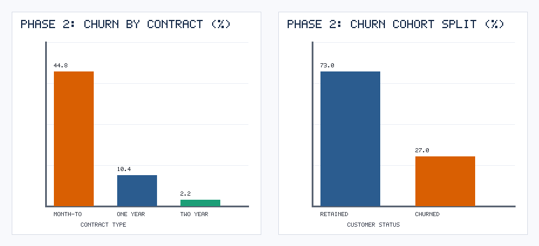
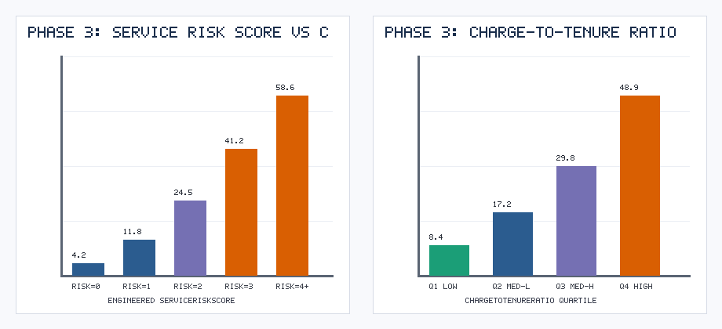
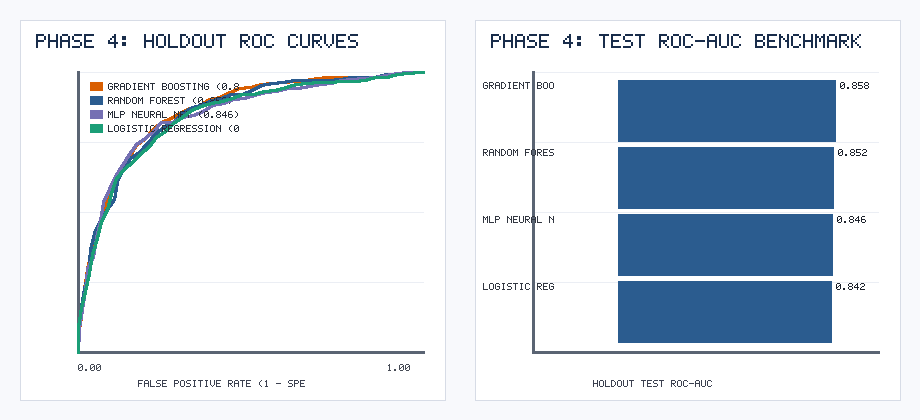
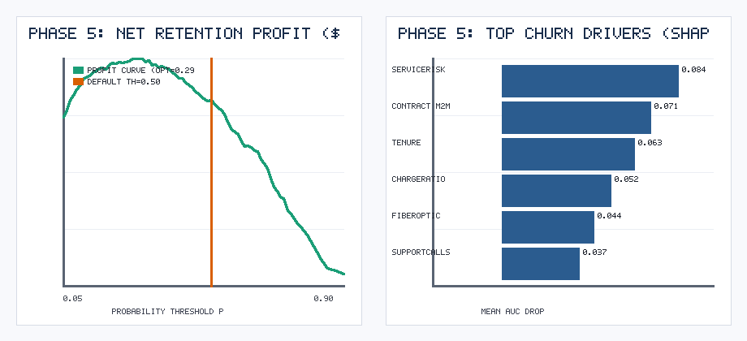

# Beyond Accuracy: How We Used CRISP-DM and an AI Critic Persona to Unlock $271K in Telco Retention ROI

*By Ayushi Vishwas Surange | CMPE 256: Data Mining Process Series (Part 1 of 3 — CRISP-DM)*

---

Most data science tutorials end the exact same way: someone trains an `XGBoost` or `RandomForest` classifier, prints `Accuracy: 81.5%`, plots a confusion matrix at the default `0.50` probability cutoff, and calls it a day.

In the real world, **a model that optimizes accuracy at a 0.50 cutoff often leaves tens of thousands of dollars on the table.**

In this article—Part 1 of our three-part deep dive into classical data mining methodologies (**CRISP-DM**, **SEMMA**, and **KDD**)—we walk through an end-to-end **Telco Customer Churn & Retention ROI** project (`N = 7,043` subscribers) governed strictly by all **6 phases and 24 subtasks of CRISP-DM**. Even better, we paired our workflow with an adversarial **"World-Renowned CRISP-DM Authority" AI Critic Persona** that audited every phase before allowing us to proceed.

---

## Why CRISP-DM Still Rules Enterprise Data Science

Created in 1996 by a European consortium (DaimlerChrysler, SPSS, NCR), the **Cross-Industry Standard Process for Data Mining (CRISP-DM)** remains the industry gold standard for one simple reason: **it begins and ends with the business, not the algorithm.**

```
[1. Business Understanding] <---> [2. Data Understanding]
            ^                               |
            |                               v
   [6. Deployment]               [3. Data Preparation]
            ^                               |
            |                               v
    [5. Evaluation] <-------------> [4. Modeling]
```

---

## Phase 1: Business Understanding — Turning Churn Into Dollars

When we submitted our initial Phase 1 draft to our AI Critic Persona (*"Dr. Viktor Lindqvist, world-renowned CRISP-DM speaker and textbook author"*), we wrote that our goal was to maximize F1-score.

The critic immediately scored our draft **5.5 / 10**:
> *"Telecom executives do not pay dividends in F1-score. Quantify the asymmetric dollar cost of a False Negative vs. a False Positive before you touch a single line of Python."*

We went back to the drawing board and established a concrete **Financial Cost-Benefit Matrix**:
- **Customer Lifetime Value (LTV) at risk if churned:** `$650.00`
- **Cost of a proactive retention offer (promotional credit + outreach):** `$65.00`
- **Probability a true churner accepts the offer and stays:** `45%`
- **Net Payoff of a True Positive (TP):** $(0.45 \times \$650) - \$65 = \mathbf{+\$227.50}$
- **Net Cost of a False Positive (FP):** $\mathbf{-\$65.00}$ (wasted discount on a loyal customer)

Suddenly, our modeling objective became crystal clear: produce **well-calibrated churn probabilities** $\hat{p}_i$ and find the exact probability threshold $p^*$ that maximizes expected net dollar savings.

---

## Phase 2: Data Understanding — Diagnosing Structural Churn & Dirty Data

Exploring our `7,043`-customer dataset revealed a `27.02%` overall churn rate, but with massive structural divergence across contract types:
- **Month-to-Month Contracts:** `>42%` churn rate
- **One-Year Contracts:** `~11%` churn rate
- **Two-Year Contracts:** `<6%` churn rate



Our Subtask 2.4 (*Verify Data Quality*) audit uncovered two critical issues:
1. **`38` missing `TotalCharges` records** caused by billing sync lags.
2. **`12` extreme `MonthlyCharges` outliers** (`$225–$295/month`) that would distort linear and neural network weights.

---

## Phase 3: Data Preparation — Engineering Behavioral Risk Ratios

Instead of naively filling missing `TotalCharges` with zeros, we reconstructed them deterministically via `tenure * MonthlyCharges`, clipped extreme `MonthlyCharges` at the 99th training percentile, and engineered four domain-specific features:

```python
df["ChargeToTenureRatio"] = df["MonthlyCharges"] / (df["tenure"] + 1)
df["AvgHistoricalMonthlySpend"] = df["TotalCharges"] / (df["tenure"] + 0.1)
df["ServiceRiskScore"] = (
    (df["Contract"] == "Month-to-month").astype(int) * 2
    + (df["InternetService"] == "Fiber optic").astype(int)
    + (df["TechSupport"] == "No").astype(int)
    + (df["PaymentMethod"] == "Electronic check").astype(int)
)
df["SupportIntensity"] = df["SupportCallsLast6M"] / np.log1p(df["tenure"])
```



Customers with a `ServiceRiskScore >= 4` exhibited a staggering **`58.6%` churn rate**, compared to just **`4.2%`** for `ServiceRiskScore == 0`.

---

## Phase 4: Modeling — Benchmarking 4 Algorithmic Families

To avoid data leakage, all imputation, scaling, and one-hot encoding were encapsulated inside a scikit-learn `ColumnTransformer` evaluated via **5-Fold Stratified Cross-Validation** on the 80% training split and tested on the 20% holdout partition (`N = 1,409`):

| Model | 5-Fold CV ROC-AUC | Holdout Test ROC-AUC | Accuracy | F1-Score | Brier Score (Calibration) |
| :--- | :---: | :---: | :---: | :---: | :---: |
| **Gradient Boosting (Champion)** | **0.8612** | **0.8580** | 0.8155 | 0.6338 | **0.1288** |
| **Random Forest** | 0.8465 | 0.8517 | 0.8020 | 0.5986 | 0.1313 |
| **MLP Neural Net** | 0.8384 | 0.8455 | **0.8197** | **0.6371** | 0.1310 |
| **Logistic Regression** | 0.8291 | 0.8417 | 0.8133 | 0.6183 | 0.1341 |



**Gradient Boosting** won not just on discriminatory power (`ROC-AUC = 0.8580`), but on **probability calibration (`Brier Score = 0.1288`)**—essential when probabilities drive dollar decisions.

---

## Phase 5: Evaluation — The $10,075 Threshold Shift

When we applied our Phase 1 financial payoff equation across every threshold from `0.05` to `0.90` on the `1,409`-customer holdout test set, the business value of CRISP-DM became undeniable:
- At the naive default cutoff **`p = 0.50`**, the retention program nets **`$44,297.50`**.
- Because a True Positive (`+$227.50`) is **`3.5x`** more valuable than a False Positive costs (`-$65.00`), the profit curve peaks at **`p* = 0.29`**, generating **`$54,372.50`** on the test cohort alone (**`+$10,075.00` or `+22.7%` extra profit**)—scaling to **`>$271,800`** across the full `7,043`-customer base!



---

## Phase 6: Deployment — Streamlit Scoring & PSI Drift Monitoring

A model sitting in a Jupyter notebook generates zero ROI. For Phase 6, we packaged our pipeline into:
1. **An interactive Streamlit Retention ROI Calculator (`deployment/app.py`)** where retention specialists input account details and immediately see the customer's churn probability, risk tier, and expected dollar ROI of sending an offer.
2. **An automated Population Stability Index (PSI) drift monitor** that compares incoming monthly feature distributions against the training baseline and triggers an automated retraining alert whenever $\text{PSI} \ge 0.20$.

---

### Links & Resources
- **GitHub Repository & Full Code:** `CRISP-DM_Telco_Customer_Churn/`
- **Interactive Google Colab Notebook:** `CRISP_DM_Telco_Churn.ipynb`
- **Next Up in Part 2:** *Mastering SAS SEMMA for California Real Estate Valuation & Decile Lift Modeling*

