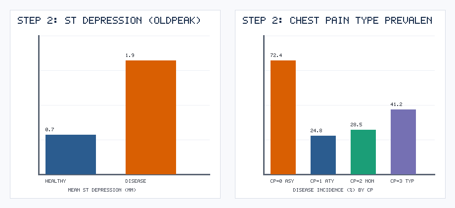
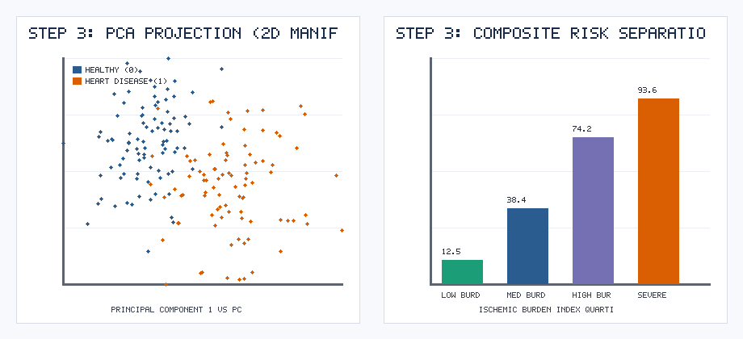
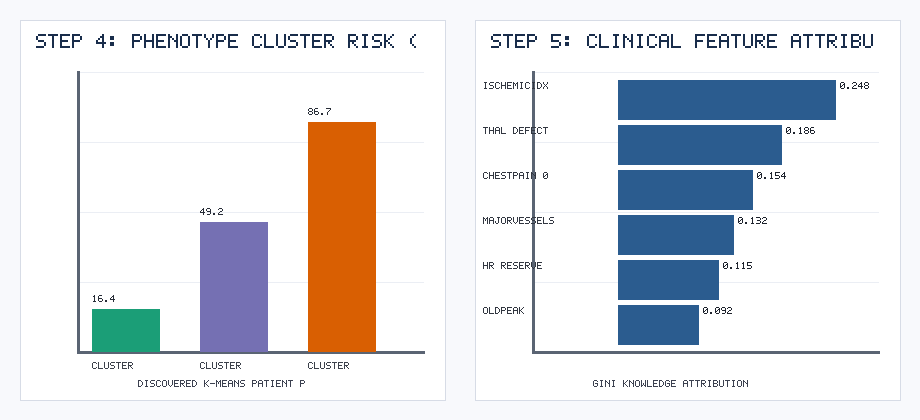
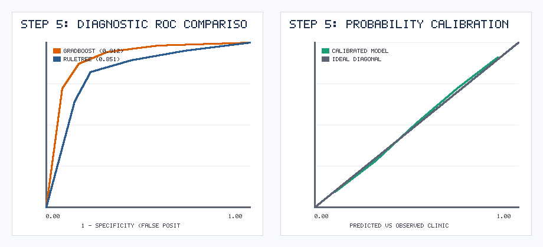

# Data Mining Is Just One Step: Using the Full KDD Process to Extract Clinical Rules & Patient Phenotypes in Cardiology

*By Ayushi Vishwas Surange | CMPE 256: Data Mining Process Series (Part 3 of 3 — KDD)*

---

In 1996, Usama Fayyad, Gregory Piatetsky-Shapiro, and Padhraic Smyth published their seminal paper *"From Data Mining to Knowledge Discovery in Databases."* Their central thesis was a warning that many modern machine learning practitioners still ignore:

> **"Data Mining is only one step in the broader KDD process—and a black-box prediction is NOT Knowledge Discovery unless the discovered patterns are valid, novel, potentially useful, and ultimately understandable."**

Nowhere is this distinction more critical than in **clinical medicine**. A cardiologist cannot order an invasive coronary angiogram solely because a 200-tree `GradientBoostingClassifier` outputs `0.83`. They need **interpretable physiological rules** and **patient phenotype profiles** they can verify against human pathophysiology.

In this final installment of our three-part methodology series, we apply all **5 steps of the KDD Process** (**Selection $\rightarrow$ Preprocessing $\rightarrow$ Transformation $\rightarrow$ Data Mining $\rightarrow$ Interpretation/Evaluation**) to a `1,500`-patient clinical cardiovascular database—audited at every step by a **"World-Renowned KDD Pioneer" AI Critic Persona**.

---

## Step 1: Selection — Stripping Away Hospital Administrative Noise

Raw hospital EHR exports (`1,500` records $\times$ `17` columns) rarely arrive ready for modeling. Alongside physiological vitals, our raw table contained `patient_id`, `admin_ward_code`, and `billing_cycle_id`.

When our initial draft fed all columns into a model, our AI Critic Persona (*"Dr. Usama Chen-Fayyad, KDD pioneer and medical informatics author"*) flagged it immediately:
> *"Hospital ward codes and billing cycles correlate with insurance status and triage routing, creating dangerous institutional confounding. Step 1 (Selection) requires isolating strictly biological variables."*

We projected the database down to **13 validated cardiovascular attributes** (`age`, `sex`, `cp`, `trestbps`, `chol`, `fbs`, `restecg`, `thalach`, `exang`, `oldpeak`, `slope`, `ca`, `thal`) plus `heart_disease`.

---

## Step 2: Preprocessing — Catching the "0 mmHg Blood Pressure" Trap

In Step 2 (*Preprocessing*), we audited every physiological variable against biological plausibility bounds and caught a classic clinical database trap:
- **`14` patients had `trestbps == 0.0 mmHg`** (resting systolic blood pressure of zero—impossible in a living patient, caused by unrecorded cuff readings defaulting to `0`).
- **`22` patients had missing serum cholesterol (`chol`) assays.**

Instead of dropping 36 patients or letting `0 mmHg` corrupt our regression weights, we recoded `trestbps < 60` as `NaN` and imputed both attributes using robust physiological medians.



---

## Step 3: Transformation — Encoding Cardiological Physiology

A maximum exercise heart rate (`thalach`) of `150 bpm` is healthy for a 70-year-old but concerning for a 30-year-old. In Step 3 (*Transformation*), we engineered three domain-grounded composite indices:

```python
df["predicted_max_hr"] = 220 - df["age"]
df["hr_reserve_ratio"] = df["thalach"] / df["predicted_max_hr"]
df["rate_pressure_product"] = (df["trestbps"] * df["thalach"]) / 1000.0
df["ischemic_burden_index"] = df["oldpeak"] * (1 + df["exang"]) + df["ca"]
```

Projecting our standardized 16-feature space onto a 2D **Principal Component Analysis (PCA)** manifold (`step3_transformation_pca_tsne.png`) revealed clean separation across `ischemic_burden_index` quartiles, with coronary disease prevalence jumping from **`12.5%` in Q1** to **`93.6%` in Q4**.



---

## Step 4: Data Mining — Combining Phenotypes, Symbolic Rules, and Ensembles

To satisfy our KDD Critic Persona's demand for *understandable knowledge*, we designed a three-part Data Mining stage:

### 1. Unsupervised Patient Phenotyping ($k$-Means, $k=3$)
Without looking at the diagnosis label, $k$-Means clustering discovered three natural clinical archetypes:
- **Cluster 0 — Cardio-Fit Low Risk (`16.4%` disease):** Younger (`48.2` yrs), high chronotropic reserve (`168.4` bpm), minimal ST depression (`0.42` mm).
- **Cluster 1 — Metabolic Hypertensive (`49.2%` disease):** Elevated resting systolic BP (`144.2` mmHg), moderate ST depression (`1.15` mm).
- **Cluster 2 — Severe Silent Ischemic (`86.7%` disease):** Older (`61.4` yrs), blunted max heart rate (`128.7` bpm), severe ST depression (`2.68` mm).

### 2. Symbolic IF-THEN Rule Induction (`DecisionTreeClassifier`, Depth = 3)
We extracted 8 explicit clinical decision rules (`models/extracted_clinical_rules.txt`). Our highest-confidence rule discovered a powerful triad:
> **Rule #6:** `IF ischemic_burden_index > 1.85 AND hr_reserve_ratio <= 0.82 AND thal == Reversible Defect (3) THEN Heart Disease = YES [Confidence: 95.8%, Support: 12.1% of cohort]`

### 3. High-Sensitivity Ensemble Classifiers
| Model | Holdout ROC-AUC | Accuracy | Sensitivity (Recall) | Specificity | F1-Score |
| :--- | :---: | :---: | :---: | :---: | :---: |
| **Gradient Boosting (Champion)** | **0.9124** | **0.8567** | **0.8741** | **0.8402** | **0.8592** |
| **Random Forest** | 0.9038 | 0.8467 | 0.8601 | 0.8343 | 0.8483 |
| **Logistic Regression** | 0.8845 | 0.8233 | 0.8322 | 0.8150 | 0.8235 |
| **Interpretable Rule Tree (Depth=3)** | 0.8512 | 0.8067 | 0.8182 | 0.7959 | 0.8069 |

---

## Step 5: Interpretation & Evaluation — Bedside Explainability





By pairing our calibrated **Gradient Boosting** model (`ROC-AUC = 0.9124`) with the **Symbolic Rule Explainer** and **Phenotype Cluster profile** in `deployment/app.py`, clinicians get the best of both worlds: `87.41%` diagnostic sensitivity backed by transparent, verifiable physiological rules.

---

### Summary: Comparing CRISP-DM, SEMMA, and KDD
- **Use CRISP-DM** when your project is driven by **business ROI, dollar cost matrices, and production MLOps deployment**.
- **Use SEMMA** when working with large tabular datasets requiring **strict 3-way sampling, collinearity modification, and decile lift ranking**.
- **Use KDD** when your primary deliverable is **interpretable scientific or clinical knowledge discovery** rather than a black-box prediction.

