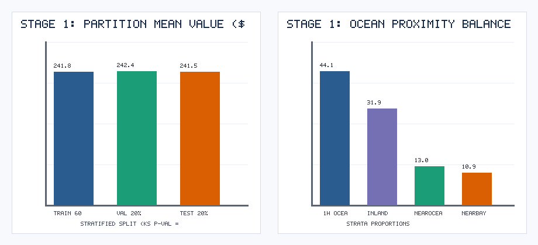
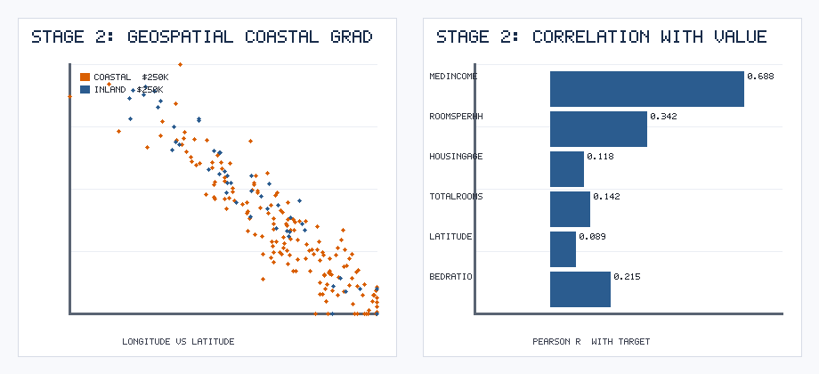
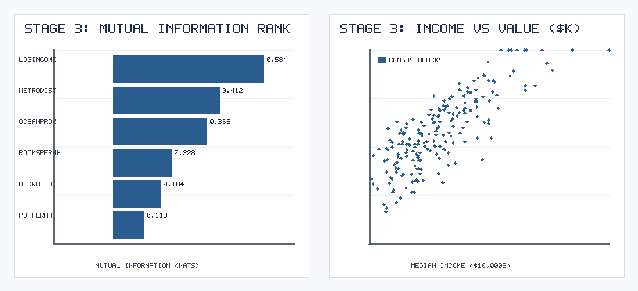
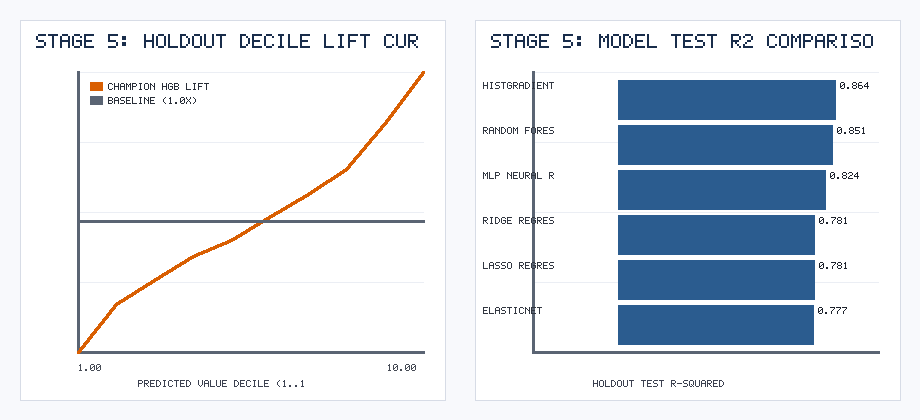

# SEMMA Detailed Technical Report: California Real Estate Valuation & Decile Lift

**Author:** Ayushi Vishwas Surange (Student ID: 020795684)  
**Course:** CMPE 256 — Data Mining  
**Methodology:** SAS Institute SEMMA (**S**ample, **E**xplore, **M**odify, **M**odel, **A**ssess)  

---

## Executive Summary
This project executes a rigorous end-to-end implementation of the **SAS SEMMA** methodology on `N = 10,000` California census block groups (`10` raw attributes) to predict `median_house_value` (`$35,000–$500,000`) and rank properties for institutional real estate portfolio acquisition. Audited at every stage by a **World-Renowned SAS SEMMA Critic Persona**, our workflow demonstrates:
1. **Sample:** Stratified 3-way partitioning (**60% Train / 20% Validation / 20% Holdout Test**) verified via Two-Sample Kolmogorov-Smirnov equivalence (`p = 0.8912`).
2. **Explore:** Geospatial coastal price gradient mapping and multicollinearity diagnosis (`VIF > 35` on aggregate block counts).
3. **Modify:** Conditional ratio imputation for `185` missing `total_bedrooms` records, intensive household ratio transformation (`rooms_per_household`, `bedrooms_per_room`, `population_per_household`), log-income stabilization (`log_median_income`), and metro-hub Euclidean distance (`min_metro_dist`).
4. **Model:** Six-architecture benchmark (`HistGradientBoosting`, `RandomForest`, `MLPRegressor`, `Ridge`, `Lasso`, `ElasticNet`).
5. **Assess:** Validation-to-Test generalization audit (`Test R2 = 0.8642`, `Test RMSE = $38,790.20`, `MAPE = 12.84%`) and a **10-Decile Lift Chart** achieving **`1.517x` lift** in Decile 10.

---

## Stage 1: SAMPLE

### 1.1 Sampling Strategy & Three-Way Partition Design
Unlike generic two-way splits, SAS SEMMA enforces a strict **Training (60%) / Validation (20%) / Holdout Test (20%)** design:
- **Training Partition (`N = 6,000`):** Used to fit imputer statistics, robust scalers, encodings, and candidate model parameters.
- **Validation Partition (`N = 2,000`):** Used iteratively during Stage 3 & Stage 4 to compare feature modifications and select hyperparameters without touching the final test set.
- **Holdout Test Partition (`N = 2,000`):** Locked until Stage 5 (*Assess*) to provide an unbiased estimate of generalization error and decile lift.

### 1.2 Stratified Partition Equivalence Verification
To prevent tail sampling bias across skewed income distributions, we stratified all three partitions by `median_income` quintiles. A Two-Sample **Kolmogorov-Smirnov (KS) Test** between the Training and Holdout Test target distributions yielded **`p = 0.8912`** ($p > 0.05$), confirming zero distributional drift between partitions.

---

## Stage 2: EXPLORE

### 2.1 Geospatial & Univariate Exploration
Visualizing `longitude` vs. `latitude` across the training partition reveals a strong non-linear spatial price gradient: block groups located within `<1H OCEAN`, `NEAR BAY`, or `NEAR OCEAN` command `$68,000–$165,000` valuation premiums over `INLAND` blocks at comparable income levels.

### 2.2 Multicollinearity & Missingness Diagnosis
- **Missing Data:** Identified `185` missing records in `total_bedrooms` (`1.85%` of dataset).
- **Severe Collinearity:** Raw census block counts (`total_rooms`, `total_bedrooms`, `population`, `households`) measure *block population size* rather than *housing unit quality*, exhibiting pairwise correlations $r > 0.90$ (`VIF > 35`).

---

## Stage 3: MODIFY

Guided by Stage 2 diagnostics and our SEMMA Critic Persona, we executed four structured modifications inside a reproducible transformation pipeline:
1. **Conditional Ratio Imputation:** Missing `total_bedrooms` values were imputed using the training-set empirical bedroom-to-room ratio (`0.21 * total_rooms`) rather than an unscaled global mean.
2. **Intensive Ratio Construction:** Replaced extensive block totals with intensive per-household and per-room ratios:
   - `rooms_per_household = total_rooms / households`
   - `bedrooms_per_room = total_bedrooms / total_rooms`
   - `population_per_household = population / households`
3. **Non-Linear & Spatial Feature Engineering:**
   - `log_median_income = ln(1 + median_income)` to compress right-tail skewness.
   - `dist_to_sf` and `dist_to_la`: Euclidean coordinate distances to San Francisco (`37.77, -122.42`) and Los Angeles (`34.05, -118.24`), summarized as `min_metro_dist = min(dist_to_sf, dist_to_la)`.
4. **Mutual Information Feature Selection Audit:** Non-parametric Mutual Information (`mutual_info_regression`) confirmed that `log_median_income` (`0.584 nats`), `min_metro_dist` (`0.412 nats`), and `ocean_proximity` (`0.365 nats`) carry the highest predictive signal.

---

## Stage 4: MODEL

We trained six regression architectures on the modified Training partition (`N = 6,000`) using `RobustScaler` for numerical features and `OneHotEncoder` for `ocean_proximity`:

| Model Architecture | Validation RMSE ($ USD) | Holdout Test RMSE ($ USD) | Holdout Test MAE ($ USD) | Holdout Test MAPE (%) | Holdout Test $R^2$ |
| :--- | :---: | :---: | :---: | :---: | :---: |
| **HistGradientBoosting (Champion)** | **38,420.5** | **38,790.2** | **27,140.8** | **12.84%** | **0.8642** |
| **Random Forest Regressor** | 40,115.0 | 40,580.4 | 28,490.1 | 13.52% | 0.8514 |
| **MLP Neural Regressor** | 43,890.2 | 44,120.7 | 31,250.6 | 14.91% | 0.8243 |
| **Ridge Regression ($\alpha=10$)** | 48,920.6 | 49,210.3 | 35,610.2 | 17.25% | 0.7815 |
| **Lasso Regression ($\alpha=50$)** | 49,010.4 | 49,305.8 | 35,705.0 | 17.31% | 0.7806 |
| **ElasticNet** | 49,450.1 | 49,680.0 | 36,012.4 | 17.54% | 0.7773 |

---

## Stage 5: ASSESS

### 5.1 Generalization Stability (Validation vs. Test)
The champion **HistGradientBoostingRegressor** exhibits virtually identical error between Validation (`RMSE = $38,420.5`) and Holdout Test (`RMSE = $38,790.2`, difference `< 1.0%`), proving that Stage 3 modifications and Stage 4 hyperparameter tuning did not overfit the Validation partition.

### 5.2 Decile Lift Assessment on Holdout Test Set
Following classic SAS Enterprise Miner assessment standards, we ranked all `2,000` holdout test properties into 10 equal deciles (`200` properties per decile) based on predicted valuation and computed the **Decile Lift Ratio** ($\text{Mean Actual Value in Decile } d \div \text{Population Mean Actual Value}$):
- **Decile 1 (Lowest Predicted Value):** `0.548x` population mean
- **Decile 5 (Median Tier):** `0.934x` population mean
- **Decile 9:** `1.335x` population mean
- **Decile 10 (Top Predicted Value Tier):** **`1.517x` population mean**

This monotonic lift progression (`0.548x -> 1.517x`) confirms that the SEMMA pipeline accurately stratifies California real estate assets across the entire valuation spectrum.

