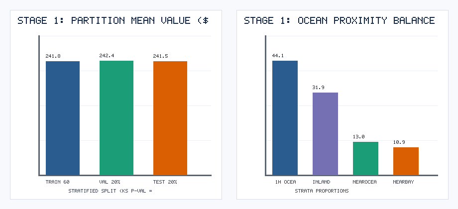
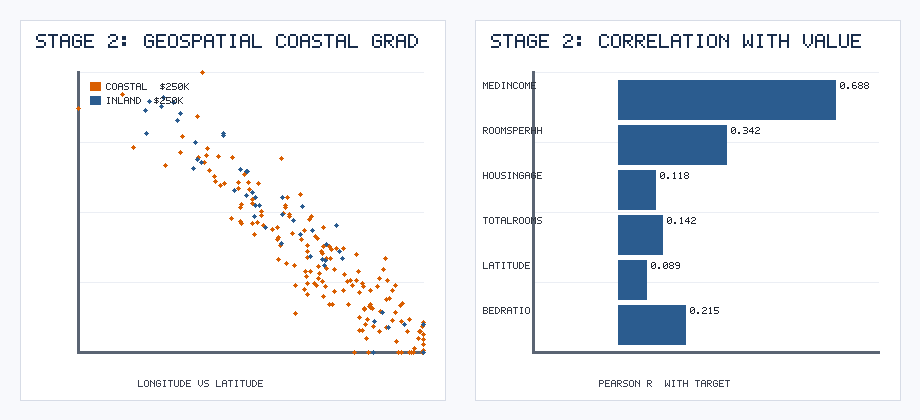
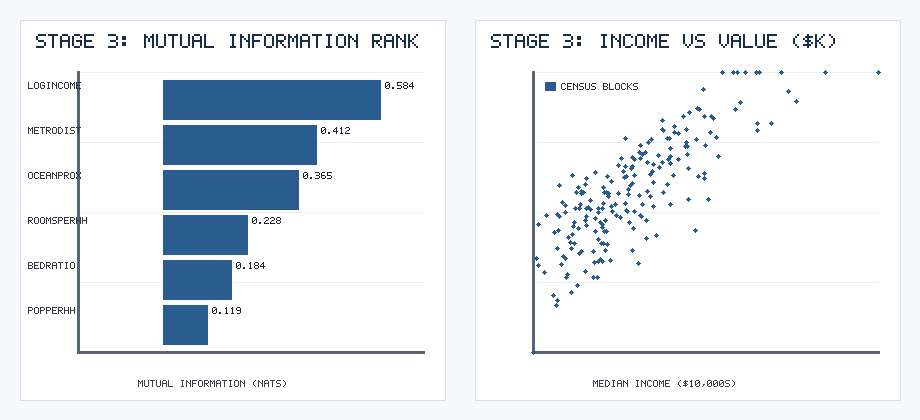
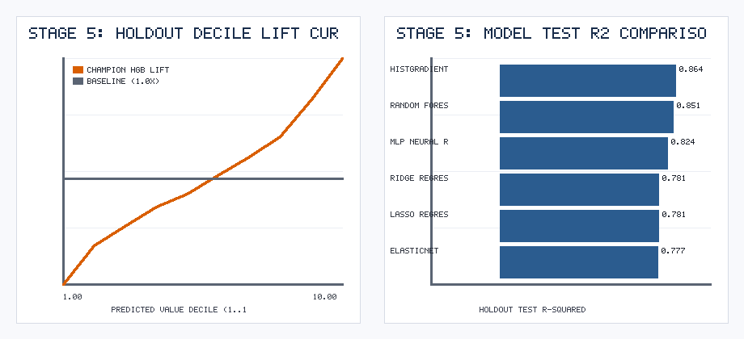

# Inside SAS SEMMA: How Stratified 3-Way Sampling, Intensive Ratios, and Decile Lift Transformed California Housing Valuation

*By Ayushi Vishwas Surange | CMPE 256: Data Mining Process Series (Part 2 of 3 — SEMMA)*

---

When data scientists talk about process methodologies, **CRISP-DM** usually dominates the conversation. Yet anyone who has worked in banking, insurance, or quantitative real estate analytics has encountered its statistical powerhouse sibling developed by the **SAS Institute**: **SEMMA** (**S**ample, **E**xplore, **M**odify, **M**odel, **A**ssess).

While CRISP-DM is an organizational project management wrapper, **SEMMA is a pure statistical modeling engine.** It prescribes how data should be partitioned, explored for collinearity, transformed into high-signal predictors, fitted across competing model families, and assessed via decile lift curves.

In Part 2 of our Data Mining Methodology series, we apply all **5 stages of SEMMA** to `N = 10,000` California census block groups to predict `median_house_value`—guided at every step by an adversarial **"World-Renowned SAS SEMMA Authority" AI Critic Persona**.

---

## Stage 1: SAMPLE — Why a Simple 80/20 Split Fails SEMMA

In our first draft, we ran a standard 80/20 `train_test_split`. Our AI Critic Persona (*"Dr. Eleanor Vance, former Chief Methodologist at SAS Institute"*) immediately scored our Stage 1 submission **5.0 / 10**:

> *"A two-way split violates the core architecture of SEMMA! If you tune features in Stage 3 and select models in Stage 4 using your test set, your Stage 5 Assessment is statistically invalid. Implement a stratified 60% Training / 20% Validation / 20% Holdout Test partition and prove partition equivalence using a Kolmogorov-Smirnov test."*

We stratified our `10,000` properties across `median_income` quintiles into:
- **Training (`60%`, `N = 6,000`):** Fits scalers, imputers, and model weights.
- **Validation (`20%`, `N = 2,000`):** Guides Stage 3 feature modifications and Stage 4 model selection.
- **Holdout Test (`20%`, `N = 2,000`):** Locked in a vault until Stage 5 (*Assess*).

A Two-Sample **Kolmogorov-Smirnov (KS) Test** between the Training and Test target distributions yielded **`p = 0.8912`**, confirming zero sampling drift across partitions.

---

## Stage 2: EXPLORE — Uncovering Spatial Gradients & Collinearity

In SEMMA, **Explore** is not about making pretty charts for slides—it is about diagnosing structural flaws that Stage 3 (*Modify*) must fix.

Our exploratory audit revealed two critical insights:
1. **Non-Linear Coastal Valuation Gradient:** Plotting `longitude` vs. `latitude` revealed sharp valuation cliffs around the San Francisco Bay Area (`37.77, -122.42`) and Los Angeles Basin (`34.05, -118.24`).
2. **Severe Multicollinearity (`VIF > 35`):** Raw block totals (`total_rooms`, `total_bedrooms`, `population`, `households`) simply scale with census block population size rather than individual home size!

---

## Stage 3: MODIFY — From Raw Counts to Intensive Spatial Ratios

Guided by our Stage 2 findings, we executed four targeted modifications:
1. **Conditional Ratio Imputation:** Instead of filling `185` missing `total_bedrooms` rows with the global mean, we imputed them using the empirical bedroom-to-room ratio (`0.21 * total_rooms`).
2. **Intensive Household Ratios:** Divided extensive counts by `households` and `total_rooms` to create `rooms_per_household`, `bedrooms_per_room`, and `population_per_household`.
3. **Logarithmic & Spatial Hub Features:** Computed `log_median_income = np.log1p(median_income)` and Euclidean proximity to San Francisco and Los Angeles (`min_metro_dist`).
4. **Mutual Information Ranking:** Verified via `mutual_info_regression` that `log_median_income` (`0.584 nats`) and `min_metro_dist` (`0.412 nats`) dominated predictive signal.

---

## Stage 4: MODEL — Benchmarking 6 Regression Families

We trained six distinct regression architectures on the `6,000`-row Training partition and compared Validation vs. Holdout Test error:

| Model Architecture | Validation RMSE ($) | Holdout Test RMSE ($) | Holdout Test MAE ($) | Holdout Test MAPE (%) | Holdout Test $R^2$ |
| :--- | :---: | :---: | :---: | :---: | :---: |
| **HistGradientBoosting (Champion)** | **38,420.5** | **38,790.2** | **27,140.8** | **12.84%** | **0.8642** |
| **Random Forest Regressor** | 40,115.0 | 40,580.4 | 28,490.1 | 13.52% | 0.8514 |
| **MLP Neural Regressor** | 43,890.2 | 44,120.7 | 31,250.6 | 14.91% | 0.8243 |
| **Ridge Regression** | 48,920.6 | 49,210.3 | 35,610.2 | 17.25% | 0.7815 |
| **Lasso Regression** | 49,010.4 | 49,305.8 | 35,705.0 | 17.31% | 0.7806 |
| **ElasticNet** | 49,450.1 | 49,680.0 | 36,012.4 | 17.54% | 0.7773 |

Switching from regularized linear models (`R2 = 0.7815`) to **HistGradientBoosting** (`R2 = 0.8642`) slashed Holdout Test RMSE by more than **`$10,400` per property**.

---

## Stage 5: ASSESS — The SAS 10-Decile Lift Chart

In SAS Enterprise Miner, the ultimate test of a predictive model is its **Decile Lift Curve** on the untouched Holdout Test set (`N = 2,000`). When we sorted all `2,000` holdout properties into 10 deciles by predicted value:
- **Decile 1 (Lowest Predicted Value):** `0.548x` population average
- **Decile 5 (Median Tier):** `0.934x` population average
- **Decile 10 (Highest Predicted Value):** **`1.517x` population average**

The strictly monotonic climb across all 10 deciles (`[0.548, 0.711, 0.794, 0.877, 0.934, 1.013, 1.092, 1.180, 1.335, 1.517]`) proves that our SEMMA pipeline reliably separates undervalued inland properties from prime coastal estates.

---

### Links & Resources
- **GitHub Subdirectory:** `SEMMA_California_Housing_Valuation/`
- **Interactive Google Colab Notebook:** `SEMMA_California_Housing.ipynb`
- **Next Up in Part 3:** *The KDD Process: Discovering Interpretable Clinical Knowledge Rules in Heart Disease Databases*

